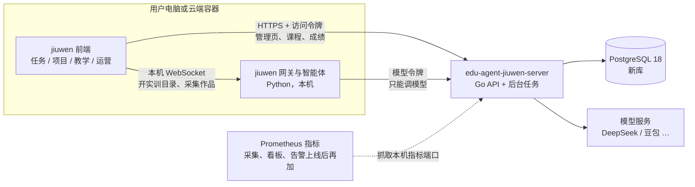

# 智教云并入 jiuwen：总体规划

状态：规划稿，2026-11-03。尚未实现。规划中的待定问题用户已全部答复，见 [决策记录](../decisions.md)。

## 1. 要解决的问题

现在有两套系统：

- **智教云**（practise.hrtiger.cn，原仓库 `ai-edu-platform`）：独立的网页平台，有运营、学校管理员、教师、学生四种角色和完整的教学流程。见 `assets/zhijiaoyun-operator-dashboard.png`。
- **edu-agent-jiuwen**（agent.hrtiger.cn）：基于 openJiuwen/WorkSwarm 的智能体客户端，只有一条窄图标侧栏。它通过插件 `edu_course` 提供「项目 → 实训 → 提交评测」。课程数据来自仓库里一份智教云后端的副本 `platform/`。见 `assets/jiuwen-projects-page.png`。

目标是把智教云的运营、教师、学生功能整体并入 jiuwen 界面，仍然只用那一条侧栏。后端改成独立的 Go 服务和独立的数据库，和原智教云彻底分开，原系统以后单独运营。

## 2. 三条硬约束

1. **客户端仓库只放客户端。** edu-agent-jiuwen 以后要打包成桌面客户端，让用户装在自己电脑上，不能把服务端代码和密钥一起打包进去。仓库里现在的 `platform/` 和平台相关的 `deploy/` 要迁出去。
2. **数据完全独立。** 新库不连原智教云的库，也不和它共享表。需要的内容通过一次性导入搬过来（见 [数据迁移](03-data-migration.md)）。
3. **界面服从 jiuwen。** 只有一条图标侧栏，视觉沿用 jiuwen 的设计语言（主色 `#2563eb`、语义 CSS 变量、`components/ui`），不搬智教云的绿色风格和它的宽侧栏。

## 3. 目标架构

要点：

- **管理页面直接调 Go API。** 运营、教师和学生的列表、表单、成绩都是普通的增删改查，由前端带访问令牌直接请求 Go 服务，不经本机 Python 中转。
- **本机 Python 只做本机才能做的事**：建实训目录、写 `LAB.md`、从会话记录里采集作品。现在 `edu_course` 已经是这种分工，采集结果交给前端，再由前端提交。
- **智能体拿不到平台令牌。** 智能体的 bash 能读到客户端进程的环境变量和配置，这是 10-30 密钥隔离时踩过的坑。它只拿一张模型令牌，只能调 Go 的模型网关，按「学员 + 课程」计量。
- **同一套前端两种形态，网页版优先**（11-03 用户确认）。网页版 agent.hrtiger.cn 给每个登录的人开一个独立的云端 WorkSwarm 容器；桌面安装版后做。两者共用同一套登录和接口，只是智能体跑的位置不同。
- **演示账号可以切换视角。** 给客户演示时，一个特殊账号在运营、教师、学生之间切换，不用退出再登录。见 [信息架构](01-information-architecture.md) §5。

## 4. 仓库划分

| 仓库 | 内容 | 不放什么 |
|---|---|---|
| `edu-agent-jiuwen`（现有） | jiuwen 客户端、宿主改动、插件 `edu_course` 和新插件 `edu_platform`、桌面打包、客户端的网页部署 | 平台后端、数据库、模型密钥 |
| `edu-agent-jiuwen-server`（新建，本仓） | Go API、后台任务、模型网关、迁移、导入工具、服务端部署 | 前端页面 |
| `ai-edu-platform`（原智教云） | 不动，以后单独运营 | — |

前后端之间唯一的契约是本仓的 `api/openapi.json`。客户端从它生成 TypeScript 类型，不各自手写字段。

本仓的骨架照同目录的 `deepfate-server`：Go 标准库 HTTP、PostgreSQL 18 + pgx、嵌入式 SQL 迁移、Prometheus 指标和告警、systemd 部署，以及 `feature_list.json` 和 ADR 这套工作约定。细节见 [后端架构](02-backend.md)。

## 5. 阶段

每一阶段结束时系统都可以上线，不会出现「迁了一半两边都不能用」的状态。

| 阶段 | 内容 | 完成标准 |
|---|---|---|
| **P0 规划与设计** | 本套文档；用 Claude Design 出信息架构和关键页面；待定问题已全部答复（11-03） | 设计稿确认，待定问题有答案 |
| **P1 地基** | 照 deepfate-server 搭 Go 仓库骨架：配置、PostgreSQL 18 与迁移、`/livez` `/readyz`、Prometheus 指标端口、备份、`make check`、OpenAPI；账号、登录、会话、角色；院校；演示账号与视角切换。客户端：登录页、按角色显示侧栏、二级栏骨架、视角切换器、宿主插槽改动。**先在本地调试**（Grok 开发、Mac 调试验证），不依赖域名 | 本地能用新账号登录，侧栏按角色显示不同入口；演示账号能在三个视角间切换，不用重新登录 |
| **P2 网页版多人与学习闭环** | 每人一个云端 WorkSwarm 容器（broker、按登录身份转发、闲置回收、资源上限）；课程与实训目录、教学班与选课、实训开放、作品提交、按评分规则 AI 初评、成绩存服务端（取代浏览器 localStorage）、模型网关与计量 | 多个真实账号同时在 agent.hrtiger.cn 上做实训，互相看不到对方的任务和文件，用量分别计到个人；现有流程不退化；仓库里的 Python `platform/` 退出线上链路 |
| **P3 教师** | 课程内容编辑与发布、评分规则工作台、作品评阅与发布、复核、成绩册、申诉、班级与学生 | 教师能独立完成「建课 → 定规则 → 评阅 → 发布成绩」 |
| **P4 运营与学校管理员** | 运营总览、院校管理、账号与批量导入、教学预算与额度、模型服务与单价、Token 计量、评阅运行、接入配置 | 运营能从空库开通一所学校并看到用量 |
| **P5 扩展** | 桌面安装版正式发布、课程测验、教学知识库、学校 SSO / 华为账号 | 按需逐项立项 |

P2 是最关键、也最重的一步：它让现在已经上线的流程从 Python 副本换到 Go，同时让网页版真正支持多人使用。P3、P4 都是在这条已经跑通的链路上加页面。

**为什么每人容器必须进 P2**：agent.hrtiger.cn 现在是一个所有访问者共用的 WorkSwarm 实例，会话、实训目录和智能体配置都是共用的。一旦按账号登录，后登录的人会覆盖前一个人的模型令牌，计量就错了，学生之间也会互相看到任务。网页版优先，就必须先做到每人隔离。做法见 [客户端接入](04-client-integration.md) §6。服务器能同时撑多少个容器还没实测（web-deploy-plan 阶段 0 的 B 关），这是 P2 开工前第一件要做的事。

## 6. 规模判断

智教云后端约 1.37 万行 Python（写得很紧凑）、181 个路由、64 张表，前端约 4500 行 Vue，后端有 698 个测试。照搬不现实，也没有必要：

- 大量代码是为旧的实训形态服务的（Prompt、RAG、Coze、LangGraph、Harness 实训，Jupyter、code-server 学习环境），在 jiuwen 里由智能体本身取代。
- 一批「回执表」和「核对面板」是为了弥补「整个平台存成一个大 JSON」的写入冲突。新库按表建模、用事务和幂等键，这部分大多不需要。
- 共享密码模式、免登录演示、请求头切换身份（`X-Demo-Role`）、Cloudflare 演示版都不迁。演示需求改由「演示账号 + 视角切换」满足。

具体的保留、合并和删除清单见 [信息架构](01-information-architecture.md) 和 [数据迁移](03-data-migration.md)。原有 Python 测试是行为说明书：每迁一个模块，就把对应测试里的业务规则改写成 Go 测试。

**说明书有两份来源**。本仓库的 `platform/` 是 10-20 从原仓库导出的副本，之后加了 WorkSwarm 相关的接口。原仓库 `ai-edu-platform` 的 `feat/redesign-categories` 分支另外走了 4 个提交：课程品类、按角色分组的侧栏 `navigation.ts`、`tokens.css`、拆分后的实训字段，用户截图里的智教云分组侧栏就是这一版。两边要合起来看。对应测试是 `platform/backend/tests/` 全部，再加上该分支的 `backend/tests/test_categories.py`、`tests/navigation.test.mjs`、`tests/platform.test.mjs`。

## 7. 文档地图

- [01 信息架构](01-information-architecture.md)：角色、侧栏、页面迁移表
- [02 后端架构](02-backend.md)：Go 模块、接口、认证、后台任务、模型网关
- [03 数据迁移](03-data-migration.md)：新库表结构、实体映射、导入流程、切换步骤
- [04 客户端接入](04-client-integration.md)：jiuwen 宿主改动、插件结构、登录与令牌、打包
- [05 设计说明](05-design-brief.md)：交给 Claude Design 的设计任务
- [决策记录](../decisions.md)
